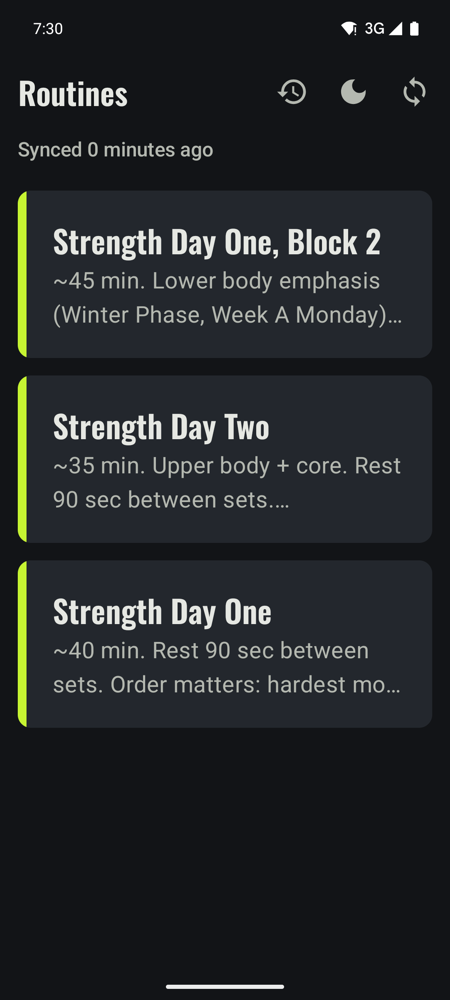
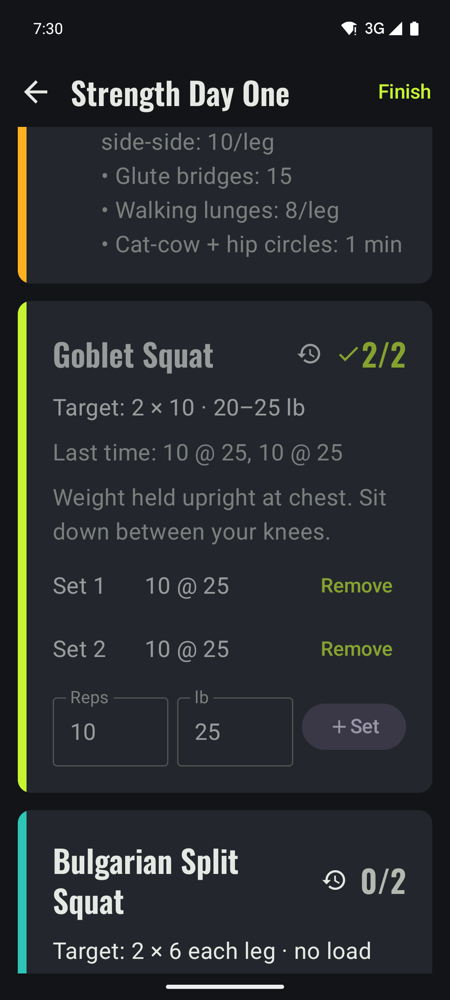
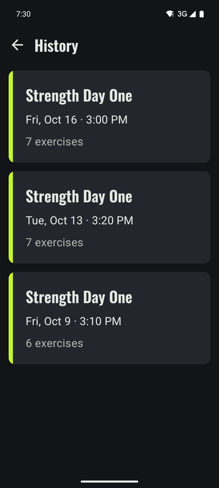

# i-workout

A small, offline-first Android app for logging strength workouts. Routines are written by Claude into Airtable; the app pulls them, lets you log Sessions in the gym with no signal, and syncs the logs back.

- Requirements, vocabulary and architecture, including the sync diagram: [docs/FOUNDATION.md](docs/FOUNDATION.md)
- Airtable tables and field IDs: [docs/airtable-schema.md](docs/airtable-schema.md)

<table>
  <tr>
    <td align="center"><br><sub><b>Routines.</b> Pick today's workout.</sub></td>
    <td align="center"><br><sub><b>Workout.</b> Target, last time, one-tap logging.</sub></td>
    <td align="center"><br><sub><b>History.</b> Past workouts; tap one to edit.</sub></td>
  </tr>
</table>

## Setup

1. **Create an Airtable base** with the three tables described in [docs/airtable-schema.md](docs/airtable-schema.md): Routines, Exercises and Sessions.
2. **Point the app at your base.** The app addresses Airtable by ID, not by name, so IDs from a new base must be copied in:
   - the base ID: `AIRTABLE_BASE_ID` in `app/build.gradle.kts`
   - the table and field IDs: `data/remote/AirtableSchema.kt`
3. **Create an Airtable personal access token** at <https://airtable.com/create/tokens>:
   - scopes: `data.records:read`, `data.records:write`
   - access: your base only
4. **Add the token to `local.properties`.** Git ignores this file; never commit the token.
   ```
   airtable.token=pat...
   ```
5. **Open the project in Android Studio** (or use `./gradlew` with JDK 17+), then run `./gradlew installDebug` with your phone connected.

**Release build:** R8-shrunk (about 3 MB), signed with a dedicated release key configured in `local.properties`. Install it on a paired phone with `./gradlew installRelease`. For the full process (key, pairing, versioning), see "Releasing to your phone" in [docs/FOUNDATION.md](docs/FOUNDATION.md). Never publish the APK: it contains your Airtable token.

## Tests

`./gradlew :app:testDebugUnitTest`: a JVM test suite that runs in seconds, with no emulator needed. It covers:
- the Airtable data contract (Sets JSON and Summary)
- the pre-fill rules
- Room queries and sync bookkeeping (under Robolectric)
- database upgrades from every past schema version
- push and pull against a fake Airtable (MockWebServer)

## Stack

Kotlin · Jetpack Compose · Room · WorkManager · Retrofit + kotlinx.serialization. Single `app` module, no DI framework.
