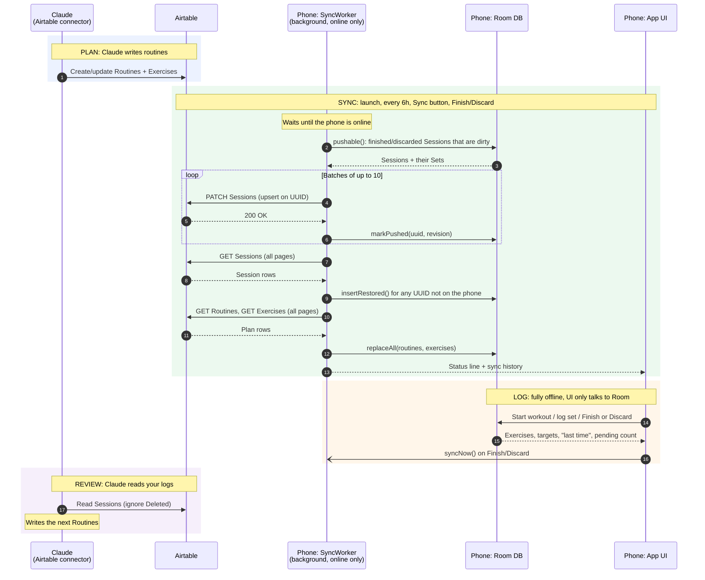

# i-workout: Foundation

The single source of truth for what the app is, the words we use, and how it's built. Update it whenever a decision changes. Airtable table and field IDs live separately in [airtable-schema.md](airtable-schema.md).

## Purpose and objectives

A small personal Android app for logging strength workouts. Claude writes the routines into Airtable. The app shows what to do, makes logging fast in the gym (including with no signal), and keeps a history Claude reads when writing the next routines.

1. **Fast logging.** A set takes one or two taps, and the screen shows what you did last time.
2. **Offline first.** Every feature works with no network. Sync happens later, on its own.
3. **Claude writes the routines,** directly in Airtable. A new routine never needs an app update.
4. **Small and light.** One user, one phone, one Airtable base on the free tier. Minimal dependencies, no server, no login.
5. **Data you can see.** Everything lives in Airtable, readable by you and by Claude.

## Scope

**In:**
- **Pick a Routine** from the active ones, newest first.
- **Log a Session:**
  - work through the Exercises in order, seeing the target, the instructions and "last time"
  - log each Set with one tap (pre-filled, editable); add or remove Sets
  - time holds (planks and the like) with a countdown that fills in the seconds held
  - tick warm-up and cool-down as done
- **History:** past Sessions with their Sets, plus per-Exercise history.
- **Edit past Sessions:** fix a Set, add or remove Sets, delete the workout, change its date. Changing the date moves start and end together, which also covers backfilling.
- **Sync:** automatic when online, plus Sync now. Shows sync status, a pending-upload count and a sync history.
- **Light/dark theme toggle**, remembered.

**Out:** programs or phases, schedules, progression rules, rest timers (between Sets; the hold timer for timed Exercises is in), editing Routines on the phone, charts, cardio, wearables, notifications, multiple users, iOS. Anything plan-level goes in a Routine's notes; Claude handles progression by writing new Routines.

## Vocabulary

There are four terms. Two describe **the plan**, which Claude writes. Two describe **the log**, which the phone writes.

- **Routine:** a workout template for one gym visit, e.g. "Strength Day One". It has a name, free-text notes (duration, rest, coaching cues) and an ordered list of Exercises.
- **Exercise:** one item in a Routine, at a fixed position. Fields:
  - **name**
  - **type:** `warm-up`, `cool-down`, `equipment` or `bodyweight`
  - **instructions:** brief focal points
  - **sets:** a number
  - **reps** and **weight:** free-text targets, e.g. `8–10`, `6 each leg`, `20–25 lb`, `light`

  An Exercise is **timed** when its reps target is a duration: `30 sec`, `45 s each side`, `1 min`. It isn't a separate type, since a hold can use equipment or not. The app detects the unit, shows a countdown timer, and logs the seconds held as the Set's reps.

  An Exercise belongs to exactly one Routine. There's no shared catalog, so the same movement in two Routines appears twice.
- **Session:** one workout actually done. It has a phone-generated UUID, a start (and end) time, the Routine it came from, notes, and its Sets.
- **Set:** one logged effort for one Exercise in a Session. It has reps and weight (lb) as numbers. Bodyweight Sets have no weight. For a timed Exercise, reps are seconds held.

**Warm-up and cool-down** are each a single Exercise, logged as one "done" tick. Their sub-items go in `instructions` as a duration line, then one bulleted item per line. Airtable keeps the newlines, and the app shows them as written:

```
8 min
• Leg swings, front-back & side-side: 10/leg
• Glute bridges: 15
```

```
┌──────────────────┐ 1      * ┌──────────────────────┐
│ ROUTINE          │─────────▶│ EXERCISE             │
│ name · notes     │ ordered  │ name · type          │
└────────▲─────────┘          │ instructions         │
         │ done from          │ sets · reps · weight │
         │                    └──────────▲───────────┘
┌────────┴─────────┐ 1      * ┌──────────┴───────────┐
│ SESSION          │─────────▶│ SET                  │
│ uuid · started   │          │ reps · weight · done │
│ notes            │          └──────────────────────┘
└──────────────────┘
```

**Worked example:** "Strength Day One", from `docs/example-training-program.html`, is a Routine with 7 Exercises in this order:
1. Warm-up
2. Goblet Squat, 2 × 10 @ 20–25 lb
3. Bulgarian Split Squat, 2 × 6 each leg, no load
4. Romanian Deadlift, 2 × 8, light
5. Dumbbell Row, 2 × 10 each side
6. Dead Bug, 2 × 8 each side
7. Cool-down

A completed Session from it has 12 Sets: one warm-up tick, two Sets for each of the five main Exercises, and one cool-down tick.

## Architecture

### Offline first: Room is the single source of truth

Screens read and write only the local Room database. The network exists only inside the sync worker. That's why the app behaves the same with no signal, and why a sync can never leave a screen half-updated.

**The UI is driven by Flows, in one direction:**

```
tap → suspend write (Room / prefs) → Flow emits → collectAsStateWithLifecycle → recompose
```

| Data | Source |
|---|---|
| Routines, Exercises, Sessions, Sets, "last time", history, pending count | Room DAO `Flow`s, which re-emit when their tables change |
| Sync status and history, theme | `StateFlow`s backed by SharedPreferences |
| Sync spinner / "Waiting for network…" | WorkManager job state, as a `Flow` |

- Screens collect Flows inside `remember { … }` so each Flow is created once.
- Purely local UI state (text being typed, open dialogs, the back stack) lives in `remember` / `rememberSaveable`.
- **Rule:** any `remember` seeded from Flow data must be keyed on that data. The pre-fill bug came from breaking this: inputs locked in their values before "last time" loaded.

### Ownership: each table has one writer

| Data | Written by | Direction |
|---|---|---|
| Routines, Exercises (the plan) | Claude, via the Airtable connector | Airtable → phone; Airtable wins |
| Sessions, Sets (the log) | the phone | phone → Airtable; restored back only to installs that lack them |

With no table having two writers, sync needs no merge logic. These rules follow from it, and **they're also written into the Airtable table and field descriptions**, so an LLM reading the base's schema sees them. Keep both copies in sync.
- **Exercise names are identity.** "Last time" and history match on the exact name, across Routines. Use identical spelling and casing for the same movement; renaming splits its history.
- **Retire a Routine by unticking Active; don't delete it.** Sessions link to it, and History shows its name.
- **Sessions are read-only in Airtable.** Edits made there aren't synced to the phone, and they're overwritten if that workout is edited on the phone again.

### Sync

Each sync **pushes, restores, then pulls**:
- **Push:** every finished or discarded Session with unsent changes is upserted, keyed on its UUID, at most 10 per request. Retries and lost responses can't create duplicates. A workout in progress never leaves the phone.
- **Restore:** all Sessions are downloaded, and any the phone doesn't have (matched by UUID) are added with their Sets parsed from the JSON. They're marked already uploaded and clean, so they never re-upload. A Session already on the phone is never overwritten, including one deleted on the phone whose deletion hasn't uploaded yet, so local edits always win. Rows marked Deleted are skipped. This brings history back after a fresh install, a reinstall or a new phone. It's still one writer: the phone only reads back rows that an install of itself wrote.
- **Pull:** all Routines and Exercises are downloaded, following Airtable's paging, and the local plan is replaced in one transaction. The plan is a few dozen rows, and a full replace also catches deletions that a delta pull would miss. Exercises with no valid Routine are skipped.

**What each Session tracks locally:**
- `dirty`: has unsent changes.
- `revision`: bumped on every change. A push clears `dirty` only if `revision` hasn't changed, so an edit made during an upload is never lost.
- `uploaded`: Airtable has a row for it. Discarding a never-uploaded Session deletes it locally. Discarding an uploaded one is a soft delete (`deleted`) that syncs.

**One sync at a time:** a process-wide lock serializes sync runs. On launch, "sync now" and the first periodic run can start together, and overlapping runs would race.

**When sync runs:** on app launch, every 6 hours, on Sync now, and on Finish, Discard or leaving an edited past workout. It's a WorkManager job that needs the network, so offline requests wait and then run on their own, even after the app is killed or the phone restarts. A failure retries up to 3 times, then waits for the next trigger. A bad token fails visibly but loses nothing: the Sessions stay unsent on the phone.



### Data contract: the Airtable side

The base has three tables: **Routines**, **Exercises** and **Sessions**. Field IDs are in [airtable-schema.md](airtable-schema.md).
- **Addressed by ID.** The app uses table and field IDs, not names (`AirtableSchema.kt`), so renaming a column in the Airtable UI doesn't break it.
- **Sets live as JSON in one cell of the Session row,** not as a table. On the free tier (about 1,000 records per base), a Sets table would need about 1,700 rows a year; JSON needs about 150 Session rows. On the phone, Sets are ordinary Room rows.

**The Sets JSON is an API, and Claude is its client.** One object per logged Set, in order. A skipped Set has no entry. Warm-up and cool-down carry only `done`.

```json
[
  {"pos":1, "exercise":"Warm-up",      "done":true},
  {"pos":2, "exercise":"Goblet Squat", "set":1, "reps":10, "weight":25},
  {"pos":3, "exercise":"Dead Bug",     "set":1, "reps":8}
]
```

- `pos` is the Exercise's position in the Routine.
- `exercise` is its name.
- `set` counts from 1.
- `weight` is in lb and left out for bodyweight.

Alongside the JSON, each uploaded row also carries:
- **Summary:** a human-readable copy, one exercise per line (`Goblet Squat: 10 @ 25, 10 @ 25`, `Warm-up ✓`). It's derived from Sets, never the other way round. It's an experimental duplicate; delete it if it isn't useful.
- **App Version:** the `versionName (versionCode)` that wrote the row. **Bump the version whenever the Sets format changes,** so any row's format can be identified.

`SetsFormatTest` pins the exact output. Change it only deliberately.

### Local schema evolution

The phone holds unsent workouts, so a broken database upgrade is the one way data could actually be lost.
- Room uses automatic migrations, and every version's schema is exported to `app/schemas/`.
- `MigrationTest` rebuilds a database at every past version from those files, fills it with data, and upgrades it to the current version. Room checks the resulting structure itself.
- A version bump is covered automatically once its schema is exported.

### Time

- Times are stored as UTC epoch milliseconds and shown in the phone's time zone.
- Changing a workout's date shifts start and end together.
- "Last time" means the latest non-deleted workout that started **before** the one being viewed, so backdated workouts compare against their own past.

### Dependency wiring

- No DI framework. `AppContainer` builds about seven objects once per process: the database, the Retrofit API, two repositories and two small prefs classes. Classes take their dependencies through their constructors, which is what lets tests pass in an in-memory database and a fake server.
- There are no ViewModels either: screens collect repository Flows directly, and a rotation just re-subscribes.
- Revisit both together if screens grow their own logic or the app splits into modules. Hilt is the standard choice then, and Koin a lighter one.

### Quality gates

All must pass before committing (see `CLAUDE.md`). **CI** (`.github/workflows/ci.yml`) runs the tests and strict lint on every push and PR, with no secrets needed.
- **Strict lint:** every check on, warnings treated as errors, and `NewApi` (calling an API above minSdk) fatal, so release builds fail on it even without running lint. The exceptions are the "newer version available" checks (`NewerVersionAvailable`, `GradleDependency`, `AndroidGradlePluginVersion`): their result depends on the day lint runs, not on the code, and Dependabot covers updates (see "Dependency updates").
- **JVM tests** (`./gradlew :app:testDebugUnitTest`, a few seconds, no emulator):
  - the data contract
  - the pre-fill rules
  - Room queries and sync bookkeeping, under Robolectric (emulating API 35)
  - database upgrades
  - push and pull against MockWebServer
- **Release build:** R8 code and resource shrinking (about 3 MB vs about 34 MB for debug), signed with a dedicated release key (see "Releasing to your phone").

## Platform and stack

- **Platform:** Android, minSdk 29, sideloaded onto your own phone. Weights in pounds.
- **Stack:** Kotlin, Jetpack Compose with Material 3, Room, WorkManager, Retrofit with OkHttp and kotlinx.serialization. One `app` module.
- **Look and feel ("Volt")**, all in `ui/Theme.kt` and `ui/Components.kt`:
  - Palette: charcoal with electric lime, as fixed light and dark schemes (no wallpaper-based dynamic color). In light mode, olive is used for text and lime for filled buttons.
  - Cards: a colored stripe per Exercise type (warm-up amber, equipment lime/olive, bodyweight teal, cool-down blue); other cards use the primary color.
  - Type: Oswald (SIL OFL; license in `licenses/`) for headings and exercise names, the system font for body text, all scaled up for arm's-length reading.
  - Icons: Material Symbols as individual vector drawables, with no icon library. The launcher icon is an orange dumbbell (`#FC7A1E`) on navy (`#14213D`), deliberately distinct from the in-app lime.
  - Feedback: a light vibration on Log set; finished exercises dim and show a ✓.
- **Airtable API:** at most 10 records per write and about 5 requests per second, both far above what this app uses.
- **Secrets:** the Airtable token lives in `local.properties` (gitignored) and is compiled into `BuildConfig`. It's scoped to one base, with record read/write access only.

## Dependency updates

**Dependabot** (`.github/dependabot.yml`) opens one grouped PR a month for all Gradle dependencies (the version catalog, plugins included, and the Gradle wrapper), and another for the GitHub Actions versions. CI checks each PR.

Monthly routine:
1. If the PR is green, merge it and pull.
2. Open the project in Android Studio. If it won't sync because the AGP version is too new for your Studio, update Studio.
3. Release to your phone (below).

If CI fails, the fix usually involves a new deprecation or lint check from an updated library. Ask Claude to fix the PR.

## Releasing to your phone

The app is sideloaded onto one phone over wireless ADB. There's no store, no CI and no APK hosting: the APK contains the Airtable token, so it must never be published, for example to GitHub Releases on this public repo.

**Signing key (one-time; already done for the author):**
- The release key lives in `release.jks` in the project root. Its path, alias and passwords are in `local.properties`: `release.storeFile`, `release.storePassword`, `release.keyAlias`, `release.keyPassword`. Both files are gitignored.
- **Back up `release.jks` and those four values.** Android only installs an update signed with the same key, so losing the key means uninstalling the app, which deletes any workouts not yet synced.
- To create a key on a new setup:
  `keytool -genkeypair -keystore release.jks -storetype PKCS12 -alias i-workout -keyalg RSA -keysize 4096 -validity 36500`
- Without a configured key, release builds fall back to the debug key, so a fresh clone still builds.

**Pairing the phone (one-time):**
1. Phone: Settings → About phone → tap **Build number** 7 times to unlock Developer options.
2. Phone: Developer options → enable **Wireless debugging**.
3. Android Studio: **Device Manager → Pair devices using Wi-Fi**, then scan the QR code from the phone.

**Each release:**
1. Bump `versionCode` and `versionName` in `app/build.gradle.kts`. This is required if the Sets format changed; uploaded rows record the version.
2. Run the tests and lint (see "Quality gates").
3. With the phone on the same Wi-Fi and Wireless debugging on, run `./gradlew installRelease`. If the phone isn't the only device connected, pick it with `ANDROID_SERIAL=<serial from adb devices>`.

This updates the app in place and keeps its data. If wireless is flaky, a USB cable and the same command work too. A debug build signed with a different key can't be replaced; uninstall it first, which deletes its local data.

## Known risks

| Risk | Impact | Mitigation |
|---|---|---|
| The token is embedded in the APK | Anyone holding the APK can extract it | Never publish the APK; the token is limited to one base. A proxy would be needed if the app is ever shared. |
| Exercises are matched by name | Renaming a movement splits its history | Naming rule in this doc and in the Airtable descriptions |
| Session edits made in Airtable aren't pulled to a phone that already has the workout | They're overwritten if the phone edits that workout again | Sessions are documented as read-only in Airtable |
| The token is fixed at build time | Rotating it means a rebuild | Acceptable for one user |
| Losing the release signing key | No more updates; reinstalling wipes unsynced workouts | Back up `release.jks` and its `local.properties` values |
| Durations of backfilled workouts are meaningless | Ended − Started is only the logging time | Not shown in the app; planning ignores them |
