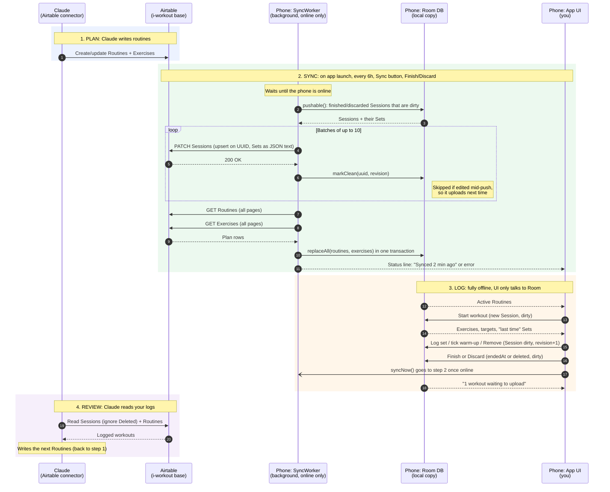

# Data flow

This page shows how data moves onto and off the phone. Each participant is a swim lane. The rules behind it are in [FOUNDATION.md](FOUNDATION.md) §5, and field IDs are in [airtable-schema.md](airtable-schema.md).

## Key rules

- **Plans flow down, logs flow up.**
  - Routines and Exercises: Claude → Airtable → phone. Airtable always wins.
  - Sessions and Sets: phone → Airtable → Claude. Only the phone writes them.
- **Every sync runs in the same order: push, then pull.**
  - The push is an upsert keyed on UUID, so retries never create duplicate rows.
  - The pull replaces the whole plan, so anything Claude deletes in Airtable also disappears from the phone.
- **The UI never talks to Airtable.** Every screen reads and writes Room, so the app behaves the same with no signal.
- **A workout in progress never leaves the phone.** A Session becomes pushable only after Finish or Discard.
